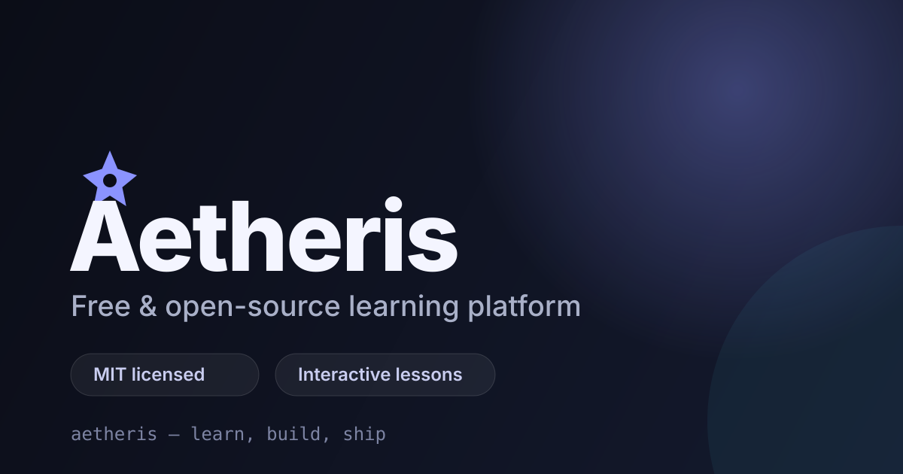

<p align="center">
  
</p>

<h1 align="center">Aetheris</h1>

<p align="center">
  <strong>Free, open-source learning — interactive lessons, quizzes, and progress that stays in your browser.</strong>
</p>

<p align="center">
  <a href="https://github.com/Omonire/Aetheris/actions/workflows/ci.yml"></a>
  <a href="LICENSE"></a>
  
  
  
  
</p>

<p align="center">
  
</p>

> **Aetheris** is a small, dependency-light Flask app for interactive courses. It ships a polished marketing site, a lesson player with quizzes and local progress, an attendance demo, and a JSON-backed content admin — all styled with [FSCSS](https://fscss.devtem.org/docs) by Omonire/Figsh.
>
> No accounts. No paywalls. No trackers. MIT licensed.

## At a glance

| | |
| --- | --- |
| **License** | MIT — free forever |
| **Runtime** | Python 3.11+ · Flask 3 |
| **Styling** | FSCSS source · compiled CSS committed |
| **Data** | JSON (`data/db.json`) · auto-seeded |
| **Deploy** | Vercel · Docker · any Python host |
| **Tests** | 9 smoke tests · CI on Windows, macOS, Linux |
| **Footprint** | ~0.2 MB source tree |

## Features

- **Landing page** with animated hero, marquee, feature grid, course preview, and blog posts.
- **Course catalog** with availability states and lesson counts.
- **Interactive lessons** — outline, content, quizzes, best score, progress bar, and reset, all client-side with `localStorage`.
- **Attendance demo** — sessions, present/approval toggles, and flash feedback.
- **Content admin** — posts, users, and SEO settings backed by JSON.
- **SEO-ready** — canonical URLs, Open Graph/Twitter cards, JSON-LD, sitemap, `robots.txt`, and a web manifest.
- **Accessible & responsive** — keyboard navigation, skip link, focus states, reduced-motion support.
- **Cross-platform** — Windows, macOS, Linux, and Docker launchers included.

## Quick start

```bash
git clone https://github.com/Omonire/Aetheris.git
cd Aetheris
```

**Windows**

```bat
run.bat
```

**macOS / Linux**

```bash
chmod +x run.sh
./run.sh
```

Both launchers create a virtual environment, install dependencies, and start the app at <http://127.0.0.1:5000>.

**Manual setup**

```bash
python -m venv .venv
# Windows: .venv\Scripts\activate
# macOS/Linux: source .venv/bin/activate
pip install -r requirements.txt
python app.py
```

Set `PORT` to change the port and `FLASK_DEBUG=0` to disable the debugger.

## Deploy

### Vercel

Vercel auto-detects the Flask app from `requirements.txt` and the `app` object in `app.py` — no `api/` wrapper needed.

```bash
npm i -g vercel
vercel login
vercel link --project aetheris-template
vercel deploy --prod
```

| Variable | Purpose |
| --- | --- |
| `AETHERIS_SECRET` | Flask session secret (use a long random value) |
| `AETHERIS_SITE_URL` | Public origin for canonical/OG URLs |
| `AETHERIS_DATA_DIR` | Optional writable directory for `db.json` |

On Vercel the JSON store automatically moves to `/tmp/aetheris` because the deployment filesystem is read-only. Serverless `/tmp` is ephemeral, so admin edits are per-instance and do not persist across cold starts — point `AETHERIS_DATA_DIR` at a persistent volume or swap `store.py` for a real database for durable writes.

### Docker

```bash
docker build -t aetheris .
docker run --rm -p 5000:5000 -v "$PWD/data:/app/data" aetheris
```

The `data` volume persists posts, users, and settings between runs.

## Styling with FSCSS

The stylesheet is written in **FSCSS** (Figured Shorthand CSS) and compiled to plain CSS. The compiled file is committed, so production needs only Flask.

```fscss
$primary: #8b93ff;
$surface: rgba(255, 255, 255, 0.04);

@define cardpad(space: 26px) {
  padding: @use(space);
}

.card {
  bg: $surface!;
  rounded: 18px;
  @cardpad(26px)
  shadow: 0 24px 60px rgba(0, 0, 0, 0.35);
}
```

Rebuild after editing `static/fscss/main.fscss`:

```bash
pip install -r requirements-dev.txt   # installs the fscss compiler
python build_css.py
```

`fscss` requires Node.js 20+ on PATH. FSCSS is not SCSS: selectors are written flat, without nesting.

## Project structure

```text
app.py               Flask routes, SEO endpoints, error handlers
store.py             JSON persistence and first-run seed data
content.py           Courses and interactive lesson data
build_css.py         Compile main.fscss -> main.css
run.bat / run.sh     Cross-platform launchers
tests/               Standard-library smoke tests
templates/           Jinja templates (public + admin)
static/fscss/        FSCSS source
static/css/          Compiled CSS (committed)
static/js/           site.js (UI) and learn.js (lessons)
static/img/          Logo and Open Graph image
data/db.json         Created automatically; gitignored
```

## Routes

| Route | Purpose |
| --- | --- |
| `/` | Landing page |
| `/courses` | Course catalog |
| `/learn` | Interactive lessons and quizzes |
| `/admin` | Content admin dashboard |
| `/admin/posts` | Create, edit, and delete posts |
| `/admin/users` | Manage demo users |
| `/admin/settings` | Edit site metadata |
| `/session/<id>` | Demo attendance session |
| `/robots.txt`, `/sitemap.xml` | SEO endpoints |
| `/healthz` | Health check |

## Testing

```bash
python -m unittest discover -s tests -v
```

The suite covers every public and admin route, SEO endpoints, static assets, attendance updates, and post/user/settings CRUD. GitHub Actions runs it on Windows, macOS, and Linux across Python 3.11 and 3.12.

## Notes

- **Admin has no authentication.** It is intentionally open for demo purposes. Put it behind a reverse proxy or add auth before deploying publicly.
- Admin pages are marked `noindex, nofollow` and excluded from the sitemap.
- Content lives in `data/db.json` and is seeded on first run. Delete the file to reset to defaults.
- Set `AETHERIS_SITE_URL` in production so canonical and social URLs match your domain.

## Contributing

Issues and pull requests are welcome.

1. Fork the repo and create a branch.
2. Make your change and run `python -m unittest discover -s tests -v`.
3. If you edited FSCSS, run `python build_css.py` and commit the compiled CSS.
4. Open a pull request describing the change.

## License

MIT — see [LICENSE](LICENSE).

<p align="center">
  Built with care by <a href="https://github.com/Omonire">Omonire Oghene-Ovie</a> and Aetheris contributors.
</p>
